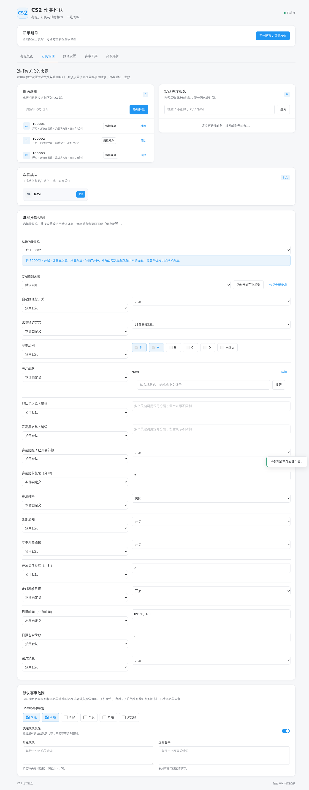
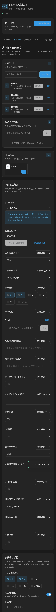

# AstrBot CS2 比赛推送插件

面向 **QQ 群管理员和 CS2 赛事观众**的 AstrBot 插件：按战队关注、赛事级别与黑名单筛选比赛，由普通 QQ 机器人自动发送赛前提醒、赛后比分、改期通知和赛程日报，在 AstrBot 内嵌 Web 面板集中管理，支持每个群独立设置推送规则。比赛数据来自 **PandaScore**；QQ 官方机器人可选作用户主动查询入口。

AstrBot plugin for Counter-Strike 2 (CS2) match notifications, team subscriptions and Major brackets in QQ groups.

> 当前源码版本为 `4.3.4`，整合主分支的每群独立规则、4.3.3 的 Major 阶段提醒，以及新版对阵图、Major 专属卡片与官方查询回复优化，仅包含 CS2 功能。赛事查询与推送需要 PandaScore API Token；主动推送仅支持 OneBot（如 NapCat），QQ 官方扩展仅支持查询。更新见[更新记录](CHANGELOG.md)，使用与验证说明见[功能证据与验收](docs/verification.md)。源码版本不代表已经发布到 GitHub Releases 或插件市场。

[安装与配置](#安装与配置) · [平台区别](#普通机器人与官方机器人怎么选) · [常用指令](#常用指令) · [图片示例](#图片效果展示) · [常见问题](#常见问题)

## 核心功能

- **按主队与赛事筛选通知**：支持战队关注、赛事级别和战队／联赛黑名单，中文外号、简称与拼写容错方便添加主队。默认推送 S/A 级，关注战队可覆盖级别限制，黑名单仍优先。见[战队搜索说明](docs/team-search.md)。
- **每群独立规则与失败恢复**：各群分别设置关注战队、筛选、赛前提醒分钟数、通知开关、日报时间和图片样式；未设置的项目沿用默认规则。赛前、赛后、开幕、日报按群记录回执，失败重试跳过成功群。见[群规则指南](docs/group-rules.md)和[通知机制](docs/verification.md#通知与筛选边界)。
- **临近改期通知与汇总**：双方队伍确定后，仅临近两小时或已提醒过的比赛发送改期通知；同次刷新 1–2 场逐条发，3 场及以上合并。远期与 TBD 赛程静默更新，减少集中调整带来的刷屏。见[改期规则与测试](docs/verification.md#通知与筛选边界)。
- **Major 瑞士轮与淘汰赛可视化**：`/cs对阵图` 查看当前阶段、指定阶段或整届赛事；瑞士轮逐轮展示，淘汰赛只连接数据源已公布的晋级关系。各阶段开赛前两小时内向启用的普通接收群发送一次阶段提醒并附图，按群去重与重试；暂停群不发送。见[Major 说明](docs/cs-major.md)和下方实际输出图。
- **Major 专属播报卡片**：赛前、赛后、已开赛补报、单场改期、赛事开幕及阶段开赛采用藏蓝与金色细节，保留原有浅底与信息布局。普通赛事保持原风格，预选赛与 RMR 不套用 Major 标识；跨日改期仍显示原定及调整后的完整日期时间。
- **AstrBot 内嵌管理与查询**：新手引导、接收群、关注、通知规则、赛程／赛果／对阵图工具、配置导入导出集中在面板；查询和预览不触发群推送。另有两端通用的 **127 人今日选手**互动，QQ 官方端可用 Markdown 和快捷按钮，详见[官方扩展与选手规则](docs/qq-official.md)。

**适合**：已有 AstrBot 和普通 QQ 机器人的观赛群，需要自动播报、多个群独立配置、可视化配置与 Major 对阵查看。

**选型边界**：本插件不提供 HLTV 实时逐回合比分、选手 Rating、新闻翻译、玩家个人战绩或其他游戏推送。这些需求应选择对应的查询或战报插件。

## 普通机器人与官方机器人怎么选

| 能力 | 普通 QQ 机器人（OneBot／NapCat） | QQ 官方机器人扩展 |
| --- | --- | --- |
| 赛程、赛果、Major、今日选手等查询 | 支持文字指令与图片回复 | 支持已开放的查询，可用 Markdown 和按钮 |
| 今日选手照片与成就图片 | 支持 | 支持；可配合 Markdown 资料排版 |
| Markdown 卡片与快捷按钮 | 使用普通图文和指令交互 | 本插件官方端的特色体验，取决于账号权限与接口支持 |
| 赛前提醒、日报、赛果等自动推送 | 支持 | 本插件官方端不提供 |
| 群组、关注和推送配置管理命令 | 支持，管理操作需管理员权限 | 不开放；由管理员在插件面板配置 |
| 是否必须配置 | 需要自动赛事推送时使用 | 可选，默认关闭 |

**官方端的优点**是 Markdown 排版更清楚、卡片更美观、按钮操作更便捷；与普通端共用赛程、配置和选手池，无需另部署一套插件。**限制**是本插件仅在用户触发的当前会话中回复，不主动推送赛事，也不会把官方回复转发到普通群。Markdown 或按钮被接口拒绝时，会回退为文字指令和图片。

**开启方法**：先在 AstrBot 接入 QQ 官方机器人，再到「插件详情 → CS2 管理 → 高级维护 → 官方机器人扩展」启用，选择账号和开放功能；「使用图片卡片和富文本回复」可控制 Markdown／卡片体验。插件直接使用 AstrBot 已配置的账号，无需重复填写官方账号凭据。官方图片内嵌需要可访问的公开图片地址；未配置或不可用时发送本地图片。详见[配置说明](docs/qq-official.md)。

## 安装要求

| 项目 | 要求与边界 |
| --- | --- |
| AstrBot | 在 AstrBot 宿主内运行；仓库尚未声明经验证的最低版本，不能据此保证所有 4.x 版本兼容。内嵌面板需要宿主提供插件可视化视图与 `register_web_api` / `astrbot.api.web`；不可用时使用独立面板。 |
| Python 与依赖 | 源码使用 Python 3.10+ 语法，实际 Python 版本还需满足所用 AstrBot 的要求；依赖为 `aiohttp>=3.9`、`Pillow>=10.0`，见 [requirements.txt](requirements.txt)。图片由本地 Pillow 渲染，无需浏览器或 LLM 服务。 |
| 数据源 | PandaScore API Token，以及访问其 API 和图片资源的网络；赛事覆盖、可用端点和请求额度取决于账户方案。不要求 HLTV Cookie，也不抓取 HLTV 实时战报。 |
| 消息平台 | 自动推送需已接入 AstrBot 的 OneBot 普通机器人在线且加入目标群；官方端需另行接入、启用扩展并选择账号。未声明 Telegram、Discord 等其他平台支持。 |

## 安装与配置

若安装或更新提示 `Plugin package exceeds the 16 MiB limit`，请使用已包含图片压缩的 4.3.2 源码包；发布前检查及本地素材维护见[安装包体积说明](docs/package-size.md)。

在 AstrBot 插件管理中使用仓库地址安装插件，确认依赖安装完成，填写 PandaScore API Token 并重载。Token 获取方式见 [PandaScore 文档](https://developers.pandascore.co/docs/authentication)。优先打开「插件详情 → CS2 管理」，按新手引导填写数据源和接收群；普通机器人必须在线并已加入目标群。引导中的连接检查不会发送测试消息。

```text
https://github.com/Aut-sep/Astrbot-plugin-CS2-match-push
```

建议首次配置后确认机器人已加入目标群，再使用以下命令：

```text
/cs设置群 123456789
/cs关注 NaVi
/cs刷新
/cs比赛
/cs状态
```

`/` 是示例唤醒前缀，实际前缀由 AstrBot 全局设置决定。管理员指令需要 AstrBot 管理员权限；`/cs帮助` 查看可用指令。连接多个机器人时，在配置中指定 `push_platform_id`。

多群可重复执行 `/cs设置群 <群号>`。新群默认继承已有设置；需要独立配置时，在「订阅管理 → 每群推送规则」选择群，逐项自定义并保存，详见[群规则指南](docs/group-rules.md)。多机器人时 `push_platform_id` 指定一个普通机器人实例。首次查询可先用 `/cs状态`、`/cs比赛` 核对内容，`/cs推送` 会实际发送到接收群。

## 管理面板

**建议优先在 AstrBot「插件详情 → CS2 管理」中配置**，内嵌页面使用 AstrBot 自身登录，新手引导会介绍普通机器人与官方扩展的分工。也可启用独立 Web 面板；独立面板在本机和远程访问时均需有效面板令牌，管理员可私聊机器人发送 `/cs面板` 获取。

面板修改先保存在当前页面，点击全局「保存配置」统一提交。赛程、赛果和对阵图查询只供查看，不触发群推送；「预览」不发送消息，「测试」会向测试目标实际发送，「正式推送」按已保存配置执行。日报会重试未成功的群；发送成功但回执尚未保存时中断，仍可能造成重发。

## 主要配置

| 配置项 | 默认值 | 用途 |
| --- | --- | --- |
| `pandascore_token` | 空 | 必填，PandaScore API Token |
| `push_platform_id` | 空 | 多机器人时指定 AstrBot 平台实例 ID |
| `image_push_enabled` | `true` | 使用赛事图片；关闭后使用文字和队标条 |
| `fetch_interval_min` | `5` | 自动刷新赛程的间隔（分钟） |
| `fetch_ahead_days` | `2` | 自动获取的未来赛程范围 |
| `web_panel_enabled` | `true` | 开启独立 Web 管理面板 |
| `web_panel_host` | `127.0.0.1` | 面板监听地址 |
| `web_panel_port` | `8765` | 面板监听端口 |

其他选项包括赛事等级、赛前提醒、日报时间、开幕提醒和黑名单。日报时间以北京时间（UTC+8）解释。日报失败时会重试未成功的目标群；手动 `/cs推送 [天数]` 不属于定时日报，不会自动重试。

## 常用指令

| 指令 | 说明 |
| --- | --- |
| `/cs比赛 [天数/全部]` | 不填查看已获取的全部赛程；填 1–30 按北京时间今天起 N 天筛选 |
| `/cs今日赛程` | 查询今日赛程快捷入口 |
| `/cs未来赛程 [天数]` | 查询未来赛程快捷入口，默认今天及后两天；支持 1–30 天 |
| `/cs赛果 [天数]` | 查询最近赛果，1–30 天，默认 3 天；也可用 `/cs赛果 比赛 <ID>` 指定比赛 |
| `/cs今日选手` | 抽取今日选手，OneBot 返回文字和本地图片 |
| `/cs对阵图 [阶段]` | 查看 Major 当前阶段、指定阶段或全部对阵 |
| `/cs状态`、`/cs群列表`、`/cs关注列表` | 查看当前配置摘要、推送群或关注战队 |
| `/cs刷新` | 立即刷新赛程（管理员） |
| `/cs设置群 <群号>`、`/cs移除群 <群号>` | 管理推送群（管理员） |
| `/cs关注 <战队名>`、`/cs取消 <战队名>` | 管理默认关注战队（管理员） |
| `/cs提醒 [分钟]` | 查看或设置默认赛前提醒时间，1–120 分钟（管理员）；本群可在面板独立设置 |
| `/cs群规则` | 在普通接收群查看本群生效规则 |
| `/cs延迟通知 [开/关]` | 查看或设置改期通知开关（管理员） |
| `/cs推送 [天数]` | 立即发送赛程日报（管理员） |
| `/cs日报` | 查看默认日报设置和子命令（管理员） |
| `/cs面板` | 私聊获取独立面板地址和令牌（管理员） |

赛程指令读取已获取且符合筛选条件的缓存；查询 7 天不会自动把默认 2 天的获取范围扩大到 7 天。需要更多赛程时，先在面板调整 `fetch_ahead_days`（1–30）并刷新。最近赛果按北京时间的**计划开赛日期**回看，不按完赛日期筛选，也沿用本群的赛事级别、关注与黑名单规则；私聊和官方端使用默认规则。

## 图片效果展示

以下使用插件已有的实际输出图片，可点击查看原图。赛前提醒、变更、开幕、日报与赛程列表展示图使用示例数据；FaZe 赛果与 Major 图取自服务器已保存的数据。图片内容不是实时赛程。

### 赛事图片：两端可查看，自动推送由普通机器人承担

<table>
  <tr>
    <td width="50%"><strong>赛前提醒 · 普通机器人自动推送</strong><br>双方队标与开赛时间。<br><br><a href="docs/images/push-upcoming.png"></a></td>
    <td width="50%"><strong>实际赛果 · FaZe 2:1 ASTRAL</strong><br>中央比分与各局胜负；两端均可查询。<br><br><a href="docs/images/result-faze-astral.png"></a></td>
  </tr>
  <tr>
    <td><strong>赛程变更 · 普通机器人自动推送</strong><br>展示调整前后的时间。<br><br><a href="docs/images/push-reschedule.png"></a></td>
    <td><strong>赛事开幕 · 普通机器人自动推送</strong><br>展示赛事名称、时间与参赛队伍。<br><br><a href="docs/images/push-opening.png"></a></td>
  </tr>
  <tr>
    <td><strong>赛程日报 · 普通机器人定时推送</strong><br>按赛事整理比赛；官方端可主动查询赛程。<br><br><a href="docs/images/push-daily.png"></a></td>
    <td><strong>赛程查询 · 两端通用</strong><br>使用 <code>/cs比赛 [天数]</code> 查询；官方端可配合快捷按钮。<br><br><a href="docs/images/query-schedule.png"></a></td>
  </tr>
</table>

### Major 晋级图：两端通用

淘汰赛沿已公布的晋级关系连接对阵；瑞士轮按轮次排列，不推测后续抽签。使用 `/cs对阵图` 或在官方菜单点击「Major 对阵」查看。

[](docs/images/major-knockout.png)

<details>
  <summary>展开查看瑞士轮实际输出图片</summary>
  <p><a href="docs/images/major-swiss.png"></a></p>
</details>

### 今日选手：图片两端通用，Markdown 与按钮为官方特色

两端发送 `/cs今日选手` 都能抽取选手。下面是插件内置的实际选手照片与成就图片素材；普通机器人同样可以收到这张图片。

<p><a href="player_cards/hltv_11893_compact.png"></a></p>

**官方端专有的展示方式**：用 Markdown 标题突出选手名，引用块显示日期与抽取状态，加粗显示战队；图片、国籍、年龄等资料配合「返回菜单」「查看今日选手」「指令帮助」按钮展示。这里展示的是实际图片素材，完整 Markdown 与按钮由 QQ 客户端渲染。资料以插件收录时为准；年龄或荣誉缺少可靠来源时不显示为确定事实。

### 每群规则管理

面板可分别设置各群规则，支持任意填写提前 1–120 分钟、复制规则和恢复继承。下面为本地浏览器使用演示数据的页面预览，非真实 QQ 投递截图。

<details>
  <summary>展开查看桌面与手机暗色面板</summary>
  <p><a href="docs/images/group-rules-desktop.png"></a></p>
  <p><a href="docs/images/group-rules-mobile-dark.png"></a></p>
</details>

## 常见问题

**关注了战队，是不是只推它的比赛？** 默认是“赛事级别或关注战队”，黑名单优先。只看主队时，可在群规则里选择“只看关注战队”并设置本群关注列表；默认规则也可清空赛事级别、保留关注优先。

**官方 QQ 机器人能自动发赛前提醒吗？** 本插件官方扩展仅提供用户触发的查询；自动赛事通知需使用 OneBot。不要把 `support_platforms` 中有官方适配器理解为两端功能完全一致。

**有重试和去重，是否保证不漏发、不重发？** 不保证。API 延迟、机器人离线和任务有效期会影响投递；发送成功到回执保存之间进程中断仍可能重发。改期待发队列未持久化，不承诺重启后恢复改期消息。详见[通知与筛选边界](docs/verification.md#通知与筛选边界)。

**图片能证明哪些功能？** 赛事图说明图片布局，群规则图展示演示数据下的实际面板。它们不能证明所有适配器、账户权限和真实消息投递都已验收。现有测试复现方式、覆盖范围和待补证据见[功能证据与验收](docs/verification.md)。

## 注意事项

- 独立面板接口要求有效面板令牌；本机访问也需要登录。容器部署还需映射端口。AstrBot 内嵌页面使用宿主登录。
- 面板里的「预览」不会发送消息；「测试」会向已配置的测试目标发送实际消息；正式推送按已保存配置发送。
- 图片推送默认开启。若图片中文字体缺失，可安装 Noto Sans CJK 或文泉驿字体后重载插件。
- 数据保存在 AstrBot 插件数据目录 `data/plugin_data/astrbot_plugin_cs_match/`。完整备份建议停用插件后复制整个目录，至少保存 `cs_data.json`（配置与通知状态）和 `qq_daily_players.sqlite3`（今日选手记录，如已生成）；面板配置导出不包含凭据、通知状态或抽签数据库。
- PandaScore 赛程可能有延迟或缺失；实际数据以数据源为准。接口正常返回后才记录发送成功。
- QQ 官方查询扩展默认关闭；启用后只允许用户触发的当前会话查询，官方侧不开放管理指令，也不发送主动赛事通知。配置说明见 [QQ 官方适配器说明](docs/qq-official.md)。
- 仓库尚未提供明确的许可证文件，复用授权需向作者确认；第三方队标、照片与资料仍归其权利人所有。

更新前建议备份插件数据。升级保留插件标识 `astrbot_plugin_cs_match` 和原数据目录。问题反馈请提供插件与 AstrBot 版本、适配器、复现步骤和脱敏日志，不要发送 Token 或面板令牌。
