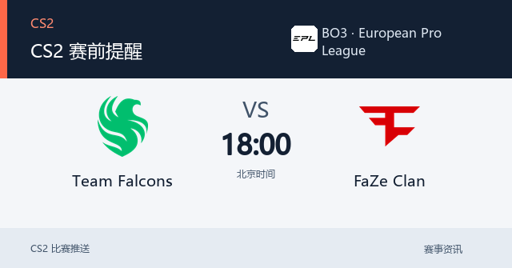
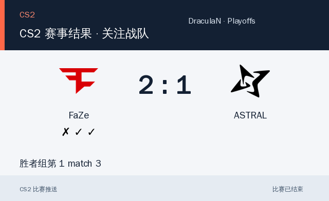
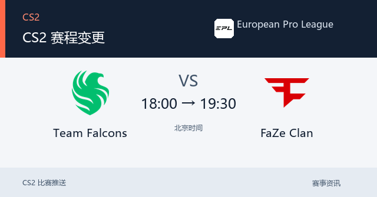
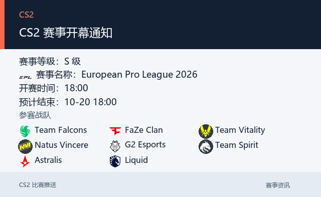
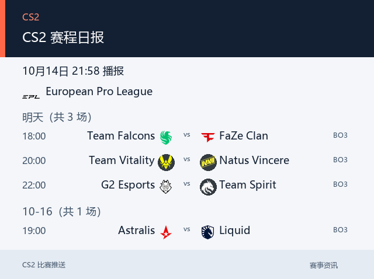
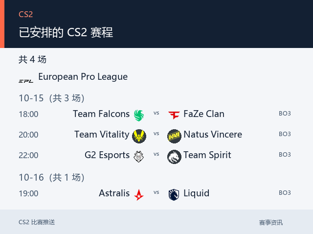
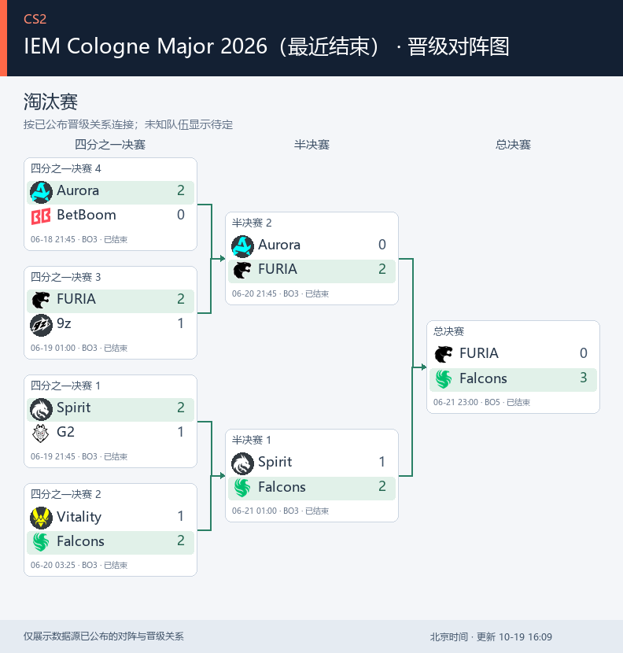
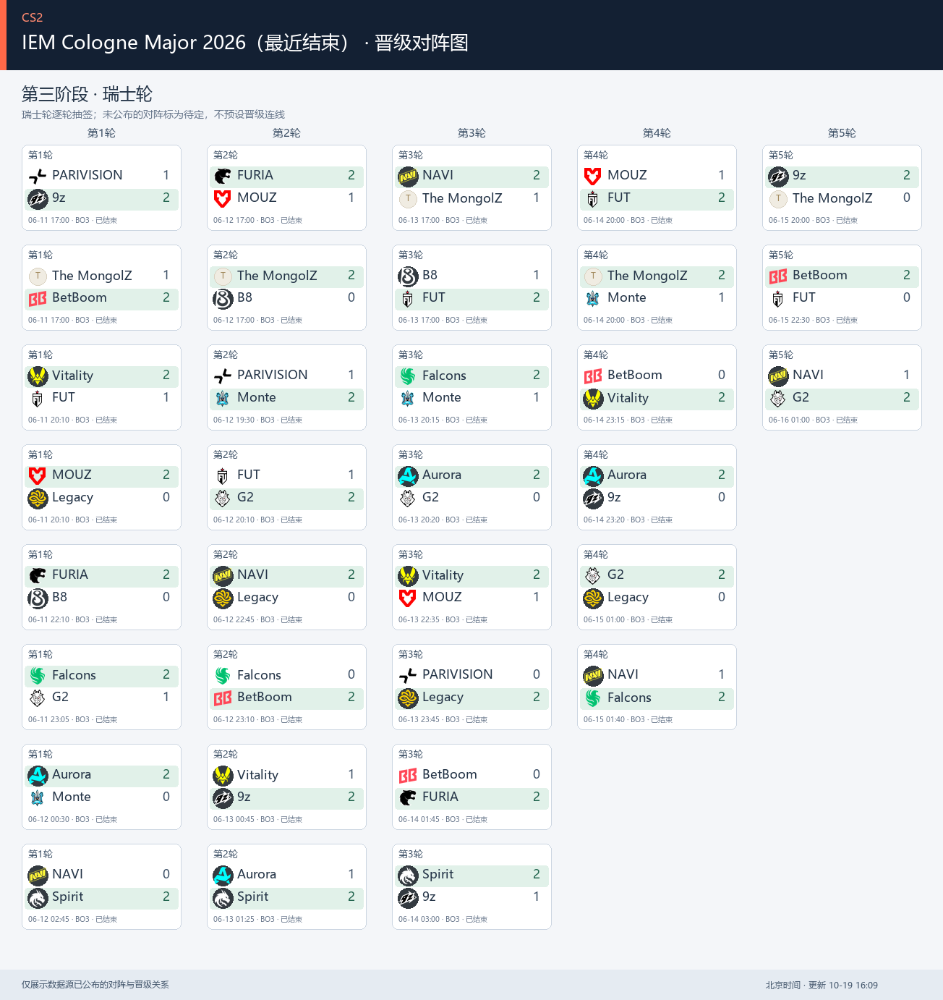

# CS2 比赛推送插件

在 QQ 中查赛程、看比分、关注主队，自动接收 CS2 赛事提醒；还可以查看 Major 晋级图、抽取今日选手。普通机器人负责完整功能和自动推送，QQ 官方机器人可作为带 Markdown 和按钮的查询入口。比赛数据来自 PandaScore。

> 当前源码版本为 `4.3.3`，仅包含 CS2 功能。更新内容见[更新记录](CHANGELOG.md)；GitHub Release 与插件市场的发布状态以各自页面为准。

## 特色功能

- **主队优先**：按赛事级别、关注战队和黑名单筛选；支持中文外号、简称与拼写容错，快速找到想看的比赛。
- **完整赛事播报**：赛前提醒、临时改期、赛后比分、赛程日报和赛事开幕通知。已追踪比赛提前开赛且未提醒时，补发“已开赛”通知；日报按群记录发送结果，失败时重试未成功的群。
- **图片看比赛**：双方队标、开赛时间、比分和各局胜负集中展示；赛程按赛事分组，也可切换文字模式。
- **改期通知防刷屏**：双方队伍均已确定，原定或新开赛时间在未来两小时内、或已发过赛前提醒的比赛才通知。同一次刷新 1–2 场分别提醒，3 场及以上合成简约汇总；远期和 TBD 赛事静默更新，不补发旧变更。失败仅重试未收到的群，关闭图片模式时使用文字。
- **Major 晋级图**：`/cs对阵图` 默认查看当前阶段，支持瑞士轮、淘汰赛或整届赛事；只展示数据源已公布的对阵与晋级关系。Major 各阶段开赛前 2 小时内，普通机器人向已有推送群发送一次提醒并附该阶段对阵图，逐群持久化去重、失败重试；不补发已开赛阶段。详见 [Major 说明](docs/cs-major.md)。
- **127 人今日选手**：`/cs今日选手` 抽取或查看当日选手，展示照片、战队、位置、国籍、年龄及已收录成就。两种机器人都能使用；当天共用不重复选手池，重复查看保留原结果，重载不清空记录。
- **官方 Markdown 与按钮**：官方端可用标题、加粗、引用、图片和快捷按钮呈现查询结果，返回菜单、切换查询范围更方便；普通端保留文字命令和图片回复。
- **AstrBot 内嵌管理**：新手引导、订阅管理、推送设置、赛程／赛果／对阵图工具和配置备份集中在插件面板。查询只在当前会话或页面展示，不改变推送配置。

功能变更见[更新记录](CHANGELOG.md)，选手池与跨平台身份规则见 [QQ 官方扩展说明](docs/qq-official.md)。

## 普通机器人与官方机器人怎么选

| 能力 | 普通 QQ 机器人（OneBot／NapCat） | QQ 官方机器人扩展 |
| --- | --- | --- |
| 赛程、赛果、Major、今日选手等查询 | 支持文字指令与图片回复 | 支持已开放的查询，可用 Markdown 和按钮 |
| 今日选手照片与成就图片 | 支持 | 支持；可配合 Markdown 资料排版 |
| Markdown 卡片与快捷按钮 | 使用普通图文和指令交互 | 本插件官方端的特色体验，取决于账号权限与接口支持 |
| 赛前提醒、日报、赛果等自动推送 | 支持 | 本插件官方端不提供 |
| 群组、关注和推送配置管理命令 | 支持，管理操作需管理员权限 | 不开放；由管理员在插件面板配置 |
| 是否必须配置 | 需要自动赛事推送时使用 | 可选，默认关闭 |

**官方端的优点**是 Markdown 排版更清楚、卡片更美观、按钮操作更便捷；与普通端共用赛程、配置和选手池，无需另部署一套插件。**限制**是本插件仅在用户触发的当前会话中回复，不主动推送赛事，也不会把官方回复转发到普通群。Markdown 或按钮被接口拒绝时，会回退为文字指令和图片。

**开启方法**：先在 AstrBot 接入 QQ 官方机器人，再到「插件详情 → CS2 管理 → 高级维护 → 官方机器人扩展」启用，选择账号和开放功能；「使用图片卡片和富文本回复」可控制 Markdown／卡片体验。插件直接使用 AstrBot 已配置的账号，无需重复填写官方账号凭据。官方图片内嵌需要可访问的公开图片地址；未配置或不可用时发送本地图片。详见[配置说明](docs/qq-official.md)。

## 图片效果展示

以下使用插件已有的实际输出图片，可点击查看原图。赛前提醒、变更、开幕、日报与赛程列表展示图使用示例数据；FaZe 赛果与 Major 图取自服务器已保存的数据。图片内容不是实时赛程。

### 赛事图片：两端可查看，自动推送由普通机器人承担

<table>
  <tr>
    <td width="50%"><strong>赛前提醒 · 普通机器人自动推送</strong><br>双方队标与开赛时间。<br><br><a href="docs/images/push-upcoming.png"></a></td>
    <td width="50%"><strong>实际赛果 · FaZe 2:1 ASTRAL</strong><br>中央比分与各局胜负；两端均可查询。<br><br><a href="docs/images/result-faze-astral.png"></a></td>
  </tr>
  <tr>
    <td><strong>赛程变更 · 普通机器人自动推送</strong><br>展示调整前后的时间。<br><br><a href="docs/images/push-reschedule.png"></a></td>
    <td><strong>赛事开幕 · 普通机器人自动推送</strong><br>展示赛事名称、时间与参赛队伍。<br><br><a href="docs/images/push-opening.png"></a></td>
  </tr>
  <tr>
    <td><strong>赛程日报 · 普通机器人定时推送</strong><br>按赛事整理比赛；官方端可主动查询赛程。<br><br><a href="docs/images/push-daily.png"></a></td>
    <td><strong>赛程查询 · 两端通用</strong><br>使用 <code>/cs比赛 [天数]</code> 查询；官方端可配合快捷按钮。<br><br><a href="docs/images/query-schedule.png"></a></td>
  </tr>
</table>

### Major 晋级图：两端通用

淘汰赛沿已公布的晋级关系连接对阵；瑞士轮按轮次排列，不推测后续抽签。使用 `/cs对阵图` 或在官方菜单点击「Major 对阵」查看。

[](docs/images/major-knockout.png)

<details>
  <summary>展开查看瑞士轮实际输出图片</summary>
  <p><a href="docs/images/major-swiss.png"></a></p>
</details>

### 今日选手：图片两端通用，Markdown 与按钮为官方特色

两端发送 `/cs今日选手` 都能抽取选手。下面是插件内置的实际选手照片与成就图片素材；普通机器人同样可以收到这张图片。

<p><a href="player_cards/hltv_11893_compact.png"></a></p>

**官方端专有的展示方式**：用 Markdown 标题突出选手名，引用块显示日期与抽取状态，加粗显示战队；图片、国籍、年龄等资料配合「返回菜单」「查看今日选手」「指令帮助」按钮展示。这里展示的是实际图片素材，完整 Markdown 与按钮由 QQ 客户端渲染。资料以插件收录时为准；年龄或荣誉缺少可靠来源时不显示为确定事实。

## 管理面板

**建议优先在 AstrBot「插件详情 → CS2 管理」中配置**，内嵌页面使用 AstrBot 自身登录，新手引导会介绍普通机器人与官方扩展的分工。也可启用独立 Web 面板；独立面板在本机和远程访问时均需有效面板令牌，管理员可私聊机器人发送 `/cs面板` 获取。

面板修改先保存在当前页面，点击全局「保存配置」统一提交。赛程、赛果和对阵图查询只供查看，不触发群推送；「预览」不发送消息，「测试」会向测试目标实际发送，「正式推送」按已保存配置执行。日报会重试未成功的群；发送成功但回执尚未保存时中断，仍可能造成重发。

## 安装与配置

在 AstrBot 插件管理中使用仓库地址安装插件，填写 PandaScore API Token 并重载。Token 获取方式见 [PandaScore 文档](https://developers.pandascore.co/docs/authentication)。优先打开「插件详情 → CS2 管理」，按新手引导填写数据源和接收群；普通机器人必须在线并已加入目标群。引导中的连接检查不会发送测试消息。

```text
https://github.com/Aut-sep/Astrbot-plugin-CS2-match-push
```

建议首次配置后确认机器人已加入目标群，再使用以下命令：

```text
/cs设置群 123456789
/cs关注 NaVi
/cs刷新
/cs比赛
/cs状态
```

`/` 是示例唤醒前缀，实际前缀由 AstrBot 全局设置决定。管理员指令需要 AstrBot 管理员权限；`/cs帮助` 查看可用指令。连接多个机器人时，在配置中指定 `push_platform_id`。

### 主要配置

| 配置项 | 默认值 | 用途 |
| --- | --- | --- |
| `pandascore_token` | 空 | 必填，PandaScore API Token |
| `push_platform_id` | 空 | 多机器人时指定 AstrBot 平台实例 ID |
| `image_push_enabled` | `true` | 使用赛事图片；关闭后使用文字和队标条 |
| `fetch_interval_min` | `5` | 自动刷新赛程的间隔（分钟） |
| `fetch_ahead_days` | `2` | 自动获取的未来赛程范围 |
| `web_panel_enabled` | `true` | 开启独立 Web 管理面板 |
| `web_panel_host` | `127.0.0.1` | 面板监听地址 |
| `web_panel_port` | `8765` | 面板监听端口 |

其他选项包括赛事等级、赛前提醒、日报时间、开幕提醒和黑名单。日报时间以北京时间（UTC+8）解释。日报失败时会重试未成功的目标群；手动 `/cs推送 [天数]` 不属于定时日报，不会自动重试。

## 常用指令

| 指令 | 说明 |
| --- | --- |
| `/cs比赛 [天数/全部]` | 不填查看已获取的全部赛程；填 1–30 按北京时间今天起 N 天筛选 |
| `/cs今日赛程` | 查询今日赛程快捷入口 |
| `/cs未来赛程 [天数]` | 查询未来赛程快捷入口，默认今天及后两天；支持 1–30 天 |
| `/cs赛果 [天数]` | 查询最近赛果，1–30 天，默认 3 天；也可用 `/cs赛果 比赛 <ID>` 指定比赛 |
| `/cs今日选手` | 抽取今日选手，OneBot 返回文字和本地图片 |
| `/cs对阵图 [阶段]` | 查看 Major 当前阶段、指定阶段或全部对阵 |
| `/cs状态`、`/cs群列表`、`/cs关注列表` | 查看当前配置摘要、推送群或关注战队 |
| `/cs刷新` | 立即刷新赛程（管理员） |
| `/cs设置群 <群号>`、`/cs移除群 <群号>` | 管理推送群（管理员） |
| `/cs关注 <战队名>`、`/cs取消 <战队名>` | 管理关注战队（管理员） |
| `/cs推送 [天数]` | 立即发送赛程日报（管理员） |
| `/cs日报` | 查看日报设置和子命令（管理员） |
| `/cs面板` | 私聊获取独立面板地址和令牌（管理员） |

## 注意事项

- 独立面板接口要求有效面板令牌；本机访问也需要登录。容器部署还需映射端口。AstrBot 内嵌页面使用宿主登录。
- 面板里的「预览」不会发送消息；「测试」会向已配置的测试目标发送实际消息；正式推送按已保存配置发送。
- 图片推送默认开启。若图片中文字体缺失，可安装 Noto Sans CJK 或文泉驿字体后重载插件。
- 数据保存在 AstrBot 插件数据目录 `data/plugin_data/astrbot_plugin_cs_match/`。完整备份请保存 `cs_data.json`；面板配置导出不包含凭据和通知状态。
- PandaScore 赛程可能有延迟或缺失；实际数据以数据源为准。接口正常返回后才记录发送成功。
- QQ 官方查询扩展默认关闭；启用后只允许用户触发的当前会话查询，官方侧不开放管理指令，也不发送主动赛事通知。配置说明见 [QQ 官方适配器说明](docs/qq-official.md)。

更新前建议备份插件数据。升级保留插件标识 `astrbot_plugin_cs_match` 和原数据目录。问题反馈请提供插件与 AstrBot 版本、适配器、复现步骤和脱敏日志，不要发送 Token 或面板令牌。
