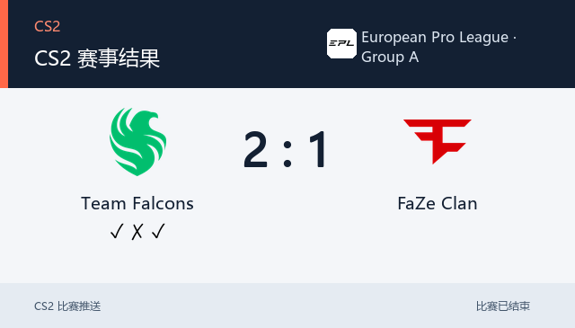

# CS2 比赛推送插件

面向 AstrBot 的 CS2 赛事插件，提供赛程查询、战队关注、赛前提醒、赛后结果、赛程日报、赛事开幕通知、Major 晋级对阵图和管理面板。支持 OneBot（aiocqhttp）及 QQ 官方适配器。数据来自 PandaScore。

版本 `4.3.0` 为本分支的纯 CS2 版本草稿。功能与变更见[更新记录](CHANGELOG.md)。QQ 官方菜单和 127 人今日选手功能见[QQ 官方说明](docs/qq-official.md)；Major 晋级图见[Major 说明](docs/cs-major.md)。

## 功能

- 统一赛程查询：`/cs比赛 [天数]` 可查看指定天数范围；`/cs今日赛程` 和 `/cs未来赛程` 是便捷入口。后两项保留为兼容快捷指令。
- 依赛事等级、关注战队和黑名单筛选赛程；支持战队别称、缩写和拼写容错，并提供常看战队快捷关注。
- 赛前提醒、赛程变更、赛后结果、赛程日报及赛事开幕提醒。开幕提醒按整届赛事合并参赛队伍并去重。
- OneBot（aiocqhttp）完整支持查询指令、今日选手、管理指令及主动赛事推送。赛程和赛果查询只回复当前会话，不改变定时推送配置。
- QQ 官方适配器可作为默认关闭的查询扩展；只响应用户在当前会话中的请求，不主动推送赛事通知，也不转发到普通 QQ 群。可按需开放帮助、赛程、Major 对阵图、赛果、今日选手、关注列表和简版状态。
- `/cs对阵图` 查看 CS Major 晋级图，默认显示当前阶段，可选阶段或完整赛事。旧 Major 指令别名继续兼容；帮助和菜单以 `/cs对阵图` 为主入口。
- 面板内置赛程、赛果、Major 对阵图和配置管理工具。赛果查询支持最近 1–30 个北京时间自然日或比赛 ID，仅在面板展示。
- 赛程图片与 Major 对阵图使用缓存，减少重复读取、下载及绘图。
- `/cs` 提供文字菜单；`/cs今日选手` 在 OneBot 和 QQ 官方适配器均可使用，返回文字资料及本地图片。QQ 官方可选用带按钮的卡片回复。每日选手池为 127 人，当天全局不重复；详见[QQ 官方扩展和选手规则](docs/qq-official.md)。

## 管理面板

可从 AstrBot 插件详情打开「CS2 管理」内嵌页面，页面使用 AstrBot 自身登录。也可启用独立 Web 面板；独立面板在本机和远程访问时都必须使用有效面板令牌登录，管理员私聊机器人发送 `/cs面板` 获取地址和令牌。

面板修改先暂存在当前页面。点击一次全局「保存配置」统一提交；切换页面或板块不会分别保存设置。可以预览内容、向测试目标实际发送测试消息，以及按已保存规则正式推送：预览只显示结果，不发送消息；测试会实际发送到配置的测试目标；正式推送使用已保存的目标和规则。

赛事工具中的赛程、赛果和对阵图查询仅供查看，不会触发群推送或修改发送记录。每日赛程失败后会按任务规则重试尚未成功的群；已成功的群会跳过。发送成功但进程在写入回执前退出，重试仍可能造成该群重复收到消息。

## 推送效果

以下图片展示 CS2 推送样式。对阵、时间、赛事等级和比分均为演示数据，不代表真实赛程。

<table>
  <tr>
    <td width="50%"><strong>赛前提醒</strong><br>双方队标与开赛时间。<br><br></td>
    <td width="50%"><strong>比赛结果</strong><br>突出比分及各局胜负。<br><br></td>
  </tr>
  <tr>
    <td><strong>赛程变更</strong><br>展示调整前后的时间。<br><br></td>
    <td><strong>赛事开幕</strong><br>展示赛事名称、时间与参赛队伍。<br><br></td>
  </tr>
  <tr>
    <td><strong>赛程日报</strong><br>按赛事整理比赛。<br><br></td>
    <td><strong>赛程查询</strong><br>使用 <code>/cs比赛 [天数]</code> 查询。<br><br></td>
  </tr>
</table>

## 安装与配置

在 AstrBot 插件管理中使用仓库地址安装插件，填写 PandaScore API Token 并重载。Token 获取方式见 [PandaScore 文档](https://developers.pandascore.co/docs/authentication)。首次打开管理页面时按新手引导填写数据源和接收群；机器人必须在线并已加入目标群。引导中的连接检查不会发送测试消息。

```text
https://github.com/Aut-sep/Astrbot-plugin-CS2-match-push
```

建议首次配置后确认机器人已加入目标群，再使用以下命令：

```text
/cs设置群 123456789
/cs关注 NaVi
/cs刷新
/cs比赛
/cs状态
```

`/` 是示例唤醒前缀，实际前缀由 AstrBot 全局设置决定。管理员指令需要 AstrBot 管理员权限；`/cs帮助` 查看可用指令。连接多个机器人时，在配置中指定 `push_platform_id`。

### 主要配置

| 配置项 | 默认值 | 用途 |
| --- | --- | --- |
| `pandascore_token` | 空 | 必填，PandaScore API Token |
| `push_platform_id` | 空 | 多机器人时指定 AstrBot 平台实例 ID |
| `image_push_enabled` | `true` | 使用赛事图片；关闭后使用文字和队标条 |
| `fetch_interval_min` | `5` | 自动刷新赛程的间隔（分钟） |
| `fetch_ahead_days` | `2` | 自动获取的未来赛程范围 |
| `web_panel_enabled` | `true` | 开启独立 Web 管理面板 |
| `web_panel_host` | `127.0.0.1` | 面板监听地址 |
| `web_panel_port` | `8765` | 面板监听端口 |

其他选项包括赛事等级、赛前提醒、日报时间、开幕提醒和黑名单。日报时间以北京时间（UTC+8）解释。日报失败时会重试未成功的目标群；手动 `/cs推送 [天数]` 不属于定时日报，不会自动重试。

## 常用指令

| 指令 | 说明 |
| --- | --- |
| `/cs比赛 [天数/全部]` | 不填查看已获取的全部赛程；填 1–30 按北京时间今天起 N 天筛选 |
| `/cs今日赛程` | 查询今日赛程快捷入口 |
| `/cs未来赛程 [天数]` | 查询未来赛程快捷入口，默认今天及后两天；支持 1–30 天 |
| `/cs赛果 [天数]` | 查询最近赛果，1–30 天，默认 3 天；也可用 `/cs赛果 比赛 <ID>` 指定比赛 |
| `/cs今日选手` | 抽取今日选手，OneBot 返回文字和本地图片 |
| `/cs对阵图 [阶段]` | 查看 Major 当前阶段、指定阶段或全部对阵 |
| `/cs状态`、`/cs群列表`、`/cs关注列表` | 查看当前配置摘要、推送群或关注战队 |
| `/cs刷新` | 立即刷新赛程（管理员） |
| `/cs设置群 <群号>`、`/cs移除群 <群号>` | 管理推送群（管理员） |
| `/cs关注 <战队名>`、`/cs取消 <战队名>` | 管理关注战队（管理员） |
| `/cs推送 [天数]` | 立即发送赛程日报（管理员） |
| `/cs日报` | 查看日报设置和子命令（管理员） |
| `/cs面板` | 私聊获取独立面板地址和令牌（管理员） |

## 注意事项

- 独立面板接口要求有效面板令牌；本机访问也需要登录。容器部署还需映射端口。AstrBot 内嵌页面使用宿主登录。
- 面板里的「预览」不会发送消息；「测试」会向已配置的测试目标发送实际消息；正式推送按已保存配置发送。
- 图片推送默认开启。若图片中文字体缺失，可安装 Noto Sans CJK 或文泉驿字体后重载插件。
- 数据保存在 AstrBot 插件数据目录 `data/plugin_data/astrbot_plugin_cs_match/`。完整备份请保存 `cs_data.json`；面板配置导出不包含凭据和通知状态。
- PandaScore 赛程可能有延迟或缺失；实际数据以数据源为准。接口正常返回后才记录发送成功。
- QQ 官方查询扩展默认关闭；启用后只允许用户触发的当前会话查询，官方侧不开放管理指令，也不发送主动赛事通知。配置说明见 [QQ 官方适配器说明](docs/qq-official.md)。

更新前建议备份插件数据。升级保留插件标识 `astrbot_plugin_cs_match` 和原数据目录。问题反馈请提供插件与 AstrBot 版本、适配器、复现步骤和脱敏日志，不要发送 Token 或面板令牌。
